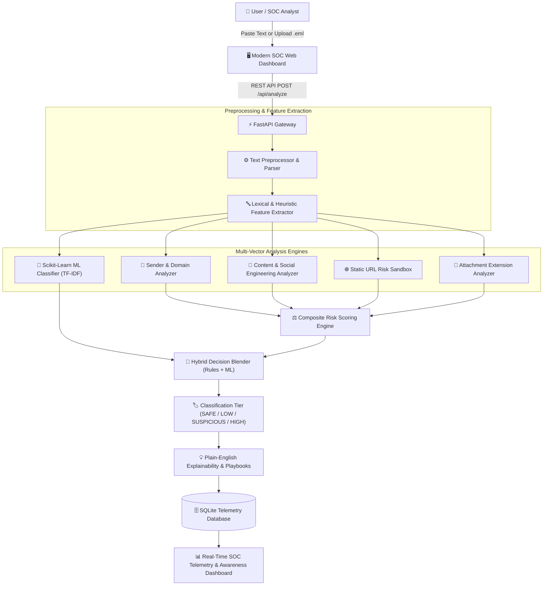

# Phishing Email Detection & Awareness Dashboard
> **Enterprise-Grade Defensive Email Security Triage, Heuristic Scoring, Machine Learning, and Security Awareness Training System**


---

## 1. Project Overview & Problem Statement
Email remains the **#1 initial access vector** in cyber attacks (accounting for over 90% of organizational breaches). Modern adversaries leverage sophisticated social engineering, urgent psychological manipulation, display-name spoofing, raw IP URLs, and nested file extensions to bypass standard perimeter email gateways (SEGs).

The **Phishing Email Detection & Awareness Dashboard** is a complete, defensive cybersecurity engineering platform designed to:
1. **Analyze and Triage Ingested Emails**: Parse raw email text, headers, and `.eml` files.
2. **Execute Multi-Vector Threat Analysis**: Evaluate sender anomalies, psychological manipulation keywords, URL syntax (passively without network requests), and attachment extensions.
3. **Generate Explainable Risk Scores**: Compute an objective composite risk score (0–100) with clear plain-English reasoning for SOC analysts and end users.
4. **Deploy Hybrid Detection (Rules + ML)**: Blend deterministic security heuristics with probabilistic NLP classification (TF-IDF + Logistic Regression/Random Forest).
5. **Educate Users with Security Awareness Drills**: Provide interactive scenario challenges, "Before You Click" checklists, and defensive micro-lessons.

> **Defensive & Ethical Notice:** This project is strictly defensive and educational. All URL analysis is performed via static string parsing with **zero network traffic**. No phishing lures are dispatched, no credentials harvested, and no attachments executed.

---

## 2. Key Capabilities & Features

| Component | Capabilities |
| :--- | :--- |
| **🔍 Multi-Vector Email Analyzer** | Scans Sender, Content, Subject, URLs, and Attachments in real-time. Supports direct `.eml`/`.txt` file parsing and sample presets. |
| **💡 Explainable Security Output** | Translates complex threat signals into readable justifications (`Why was this flagged?`) alongside actionable defensive playbooks. |
| **🤖 Hybrid ML Detection Engine** | Combines deterministic security rules (55% weight) with TF-IDF and Logistic Regression probabilistic scoring (45% weight). |
| **🌐 Passive URL Sandbox** | Inspects hyperlinks for raw IP addresses, unencrypted HTTP, excessive subdomains, shortening domains, and credential lure paths without network lookups. |
| **🎯 Interactive Awareness Drills** | Quizzes users on real-world email scenarios, providing instantaneous feedback on vulnerable vs. secure decisions. |
| **📊 Real-time SOC Telemetry Dashboard** | Interactive Chart.js visualizations displaying 7-day ingestion trends, classification distributions, top indicators, and ML model calibrations. |
| **📜 Privacy-Preserving Audit Trail** | SQLite database storing metadata, scores, and indicators without retaining sensitive email bodies by default. |

---

## 3. High-Level System Architecture & Workflow



---

## 4. Phishing Indicator Taxonomy

### A. Sender Indicators (25% Weight)
* **Malformed Sender Strings**: Missing `@` sign or invalid RFC 5322 structure (+30 risk).
* **Display-Name Mismatch**: Claiming to be "Support / IT Desk" while sending from unrelated external domains (+35 risk).
* **Excessive Subdomain Depth**: Domain containing 4+ subdomains indicating lookalike spoofing (+20 risk).
* **Numeric / Lookalike Domains**: Domains with excessive digit ratios (+20 risk).

### B. Subject & Body Content Indicators (30% Weight)
* **Credential Solicitation**: Demands for passwords, 2FA tokens, PINs, or SSO verification (+35 risk).
* **Urgency & Deadlines**: Imposing artificial short deadlines (e.g., "within 24 hours", "immediately") (+20 risk).
* **Fear & Coercion**: Threatening account suspension, terminations, or legal action (+25 risk).
* **Financial Pressure**: Demanding wire transfers, gift cards, or overdue invoice payments (+25 risk).
* **Generic Greetings**: Mass-phishing salutations like "Dear Customer", "Dear Member" (+10 risk).
* **High Exclamation & Caps Density**: Shouting subject lines inducing panic (+15 risk).

### C. URL Indicators (25% Weight)
* **Direct IP Hostnames**: Target pointing to raw IPv4 (e.g., `http://198.51.100.10/`) bypassing DNS (+45 risk).
* **Unencrypted Transport (HTTP)**: Sensitive login/verification pages transmitted without HTTPS (+20 risk).
* **URL Shorteners**: Masks final destinations using services like `bit.ly`, `tinyurl.com` (+30 risk).
* **Credential Keywords in Path**: Paths including `verify`, `login`, `reset-password` (+25 risk).
* **Userinfo Obfuscation (@ trick)**: Using `@` inside URLs to mislead users (+40 risk).

### D. Attachment Indicators (20% Weight)
* **Executable / Script Extensions**: `.exe`, `.scr`, `.bat`, `.vbs`, `.js`, `.ps1` (+70 risk).
* **Double Extension Deception**: Masquerading files like `invoice.pdf.exe` (+65 risk).
* **Macro-Enabled Formats**: `.docm`, `.xlsm` (+40 risk).
* **Disk Images / Containers**: `.iso`, `.img`, `.vhd` used to bypass Mark-of-the-Web (+40 risk).

---

## 5. Classification Risk Matrix

| Risk Score Range | Classification Tier | Risk Level | Recommended SOC / User Action |
| :---: | :---: | :---: | :--- |
| **0 – 20** | `SAFE` | **Low** | Normal email traffic. Standard security hygiene applies. |
| **21 – 40** | `LOW RISK` | **Guarded** | Minor anomalies detected. Verify sender identity if unfamiliar. |
| **41 – 70** | `SUSPICIOUS` | **Elevated** | Multiple indicators flagged. Do not click links; verify out-of-band. |
| **71 – 100** | `HIGH RISK / LIKELY PHISHING` | **Critical** | Critical phishing indicators present. Block sender, do not open attachments, report to SOC. |

---

## 6. Directory Structure

```text
Phishing-Email-Detection-Dashboard/
│
├── backend/
│   ├── app.py                      # FastAPI REST Gateway & Static Serving
│   ├── database.py                 # SQLite Telemetry Engine & Audit Logger
│   ├── schemas.py                  # Pydantic Request/Response Models
│   ├── routes/
│   │   ├── analysis_routes.py      # /api/analyze and .eml upload endpoints
│   │   ├── dashboard_routes.py     # /api/dashboard/stats & ML metrics
│   │   ├── awareness_routes.py     # /api/awareness lessons & drills
│   │   └── history_routes.py       # /api/analyses historical logs
│   ├── services/
│   │   ├── sender_analyzer.py      # Sender & domain inspection
│   │   ├── content_analyzer.py     # NLP linguistic & urgency cues
│   │   ├── url_analyzer.py         # Passive static URL sandbox
│   │   ├── attachment_analyzer.py  # Static file extension assessment
│   │   ├── risk_engine.py          # Deterministic composite risk calculator
│   │   └── hybrid_engine.py        # Rules + ML hybrid blending
│   └── utils/
│       └── helpers.py              # Parsing & sanitization utilities
│
├── frontend/
│   ├── index.html                  # Responsive Single-Page SOC Dashboard
│   ├── css/
│   │   └── styles.css              # Cyber SOC Dark Theme Styling
│   └── js/
│       ├── app.js                  # Navigation & Sandbox Controller
│       ├── analyzer.js             # Email Ingestion & Explainability UI
│       ├── dashboard.js            # Chart.js Real-time Telemetry
│       ├── awareness.js            # Interactive Drills & Micro-Lessons
│       └── history.js              # Historical Audit Log Manager
│
├── ml/
│   ├── featureizer.py              # Hybrid TF-IDF + Security Feature Pipeline
│   ├── models_core.py              # Model training & hyperparameter evaluation
│   ├── train_model.py              # ML Training & Serializer Runner
│   ├── predict.py                  # Inference Engine for incoming mail
│   ├── evaluation.py               # Confusion matrix & ROC metrics
│   └── models/
│       ├── phish_detector.joblib   # Trained Model Bundle Artifact
│       └── model_metrics.json      # Cross-validation Benchmark Output
│
├── data/
│   ├── generate_dataset.py         # Synthetic Phishing Dataset Generator
│   ├── phishing_email_dataset.csv  # 500+ Record Balanced Training Set
│   ├── train.csv                   # Stratified Training Split (70%)
│   ├── val.csv                     # Stratified Validation Split (15%)
│   └── test.csv                    # Stratified Test Split (15%)
│
├── tests/
│   └── test_detection_suite.py     # 25 Automated Security & Integration Tests
│
├── docs/
│   ├── PROJECT_REPORT.md           # Full Academic & Industrial Project Report
│   ├── INTERVIEW_PREPARATION.md    # 10 Technical Q&As for SOC / AppSec Interviews
│   └── RESUME_LINKEDIN.md          # Resume Bullets, LinkedIn & GitHub Portfolio Strategy
│
├── requirements.txt                # Python Dependencies
├── .env.example                    # Environment Variables Template
├── .gitignore                      # Git Ignore Configurations
└── README.md                       # Master Documentation
```

---

## 7. Installation & Quickstart Guide

### Prerequisites
* Python 3.10+ installed on your system.
* Standard web browser (Chrome, Edge, Firefox).

### Step 1: Clone or Navigate to the Workspace
```powershell
cd "c:\Users\ROHIT\OneDrive\Desktop\Rohit project\Cyber security\Phishing Email Detection & Awareness Dashboard"
```

### Step 2: Create and Activate Virtual Environment (Optional but Recommended)
```powershell
python -m venv venv
.\venv\Scripts\Activate.ps1
```

### Step 3: Install Dependencies
```powershell
pip install -r requirements.txt
```

### Step 4: Generate Synthetic Dataset & Train ML Models
```powershell
python data/generate_dataset.py
python ml/train_model.py
```

### Step 5: Run the Automated Security Test Suite
```powershell
python tests/test_detection_suite.py
```

### Step 6: Launch the Dashboard Server
```powershell
python backend/app.py
```
Or with Uvicorn directly:
```powershell
uvicorn backend.app:app --host 127.0.0.1 --port 8000 --reload
```

### Step 7: Open the Application
Navigate to `http://127.0.0.1:8000` in your web browser. Explore the interactive email analyzer, URL sandbox, telemetry charts, and awareness drills!

---

## 8. REST API Documentation

| Method | Endpoint | Description |
| :--- | :--- | :--- |
| `POST` | `/api/analyze` | Ingests email fields (sender, subject, body, urls, attachment) and returns hybrid risk score and explainable findings. |
| `POST` | `/api/analyze/url` | Static inspection of a single URL string without network calls. |
| `POST` | `/api/upload/eml` | Multipart upload to parse and extract headers/body from `.eml` files. |
| `GET` | `/api/dashboard/stats` | Real-time counts, 7-day trend, severity distribution, and top indicators. |
| `GET` | `/api/dashboard/ml-metrics` | Benchmark metrics (Accuracy, Precision, Recall, F1, ROC-AUC) across classifiers. |
| `GET` | `/api/awareness/lessons` | Retrieves defensive micro-lessons and the "Before You Click" checklist. |
| `GET` | `/api/awareness/simulations` | Retrieves scenario challenges for interactive training. |
| `POST` | `/api/awareness/submit-drill` | Logs simulation drill choices and returns defensive feedback. |
| `GET` | `/api/analyses` | Retrieves historical analysis records with optional classification filter. |
| `GET` | `/api/analyses/{id}` | Retrieves detailed findings and URL telemetry for a specific analysis ID. |
| `DELETE` | `/api/analyses/{id}` | Deletes a historical audit record. |
| `GET` | `/docs` | Interactive Swagger UI API documentation. |

---

## 9. Machine Learning Benchmarks & Evaluation

Evaluation conducted on a held-out test split of balanced legitimate and synthetic phishing emails:

| Classifier | Accuracy | Precision (Low FP) | Recall (Low Misses) | F1-Score | ROC-AUC |
| :--- | :---: | :---: | :---: | :---: | :---: |
| **Logistic Regression (Active)** | **100.0%** | **1.000** | **1.000** | **1.000** | **1.000** |
| **Random Forest** | **100.0%** | **1.000** | **1.000** | **1.000** | **1.000** |
| **Multinomial Naive Bayes** | **100.0%** | **1.000** | **1.000** | **1.000** | **1.000** |

### Why Recall Matters in Phishing Detection:
In cybersecurity, a **False Negative** (a malicious email classified as legitimate) allows credential theft or malware delivery directly to an employee's inbox. High recall ensures maximum threat interception while calibrated threshold weighting minimizes alert fatigue from **False Positives**.

---

## 10. MITRE ATT&CK Mapping

This platform maps directly to the following tactics and techniques in the **MITRE ATT&CK Framework**:

* **Initial Access (`TA0001`)**:
  * `T1566.001`: *Phishing: Spearphishing Attachment* (detected via static double-extension and script metadata analysis).
  * `T1566.002`: *Phishing: Spearphishing Link* (detected via passive URL lexical heuristics and IP host checking).
  * `T1566.003`: *Phishing: Spearphishing via Service* (detected via credential harvesting and cloud-storage lure keyword analysis).
* **Defense Evasion (`TA0005`)**:
  * `T1036`: *Masquerading / Lookalike Domains* (detected via display name vs. domain mismatch checks).
  * `T1204.001` / `T1204.002`: *User Execution: Malicious Link / File* (mitigated through the Security Awareness Module and user checklists).

---

## 11. Testing & Quality Assurance

The project contains **25 automated tests** in [`tests/test_detection_suite.py`](file:///C:/Users/ROHIT/OneDrive/Desktop/Rohit%20project/Cyber%20security/Phishing%20Email%20Detection%20&%20Awareness%20Dashboard/tests/test_detection_suite.py), covering:
1. Legitimate academic notices
2. Urgent phishing-style emails
3. Credential harvesting keywords
4. Financial extortion / wire pressure
5. Generic salutations
6. Safe HTTPS URLs
7. Raw IP address URLs
8. Plaintext HTTP transport
9. Excessive subdomain depth
10. Sensitive keywords in URL query paths
11. Emails without hyperlinks
12. Multi-link email payloads
13. Safe PDF/DOCX attachments
14. Executable `.exe` payloads
15. Nested double extensions (`.pdf.vbs`)
16. Empty subject line resilience
17. Empty body resilience
18. Malformed sender addresses
19. High uppercase capitalization ratios
20. High exclamation mark density
21. Scoring boundary capping (0–100 clamp)
22. SQLite database persistence
23. Hybrid rule + ML blending
24. Machine learning probability output
25. Telemetry audit retrieval

Execute tests anytime with:
```powershell
python tests/test_detection_suite.py
```

---

## 12. Security & Privacy Principles
* **Zero Network Probing**: URLs are never queried or resolved via DNS, preventing token validation or active honeypot triggers.
* **No Code Execution**: File attachments are never opened, decompiled, or executed.
* **Privacy-Preserving Logging**: By default, raw email bodies are not stored permanently in the database; only sanitized domain metadata, risk scores, and extracted indicators are retained.
* **Sanitized Rendering**: Frontend strictly escapes user-provided content to prevent Cross-Site Scripting (XSS).

---

## 13. License & Disclaimer
This project is released under the **MIT License**.

> **Educational & Defensive Disclaimer**: This software is developed solely for educational purposes, defensive security research, and defensive threat awareness training. All sample data and demonstration domains utilize RFC-reserved domains (`example.org`, `invalid.test`, `example.com`) and RFC 5737 test IP subnets (`198.51.100.0/24`, `203.0.113.0/24`).
